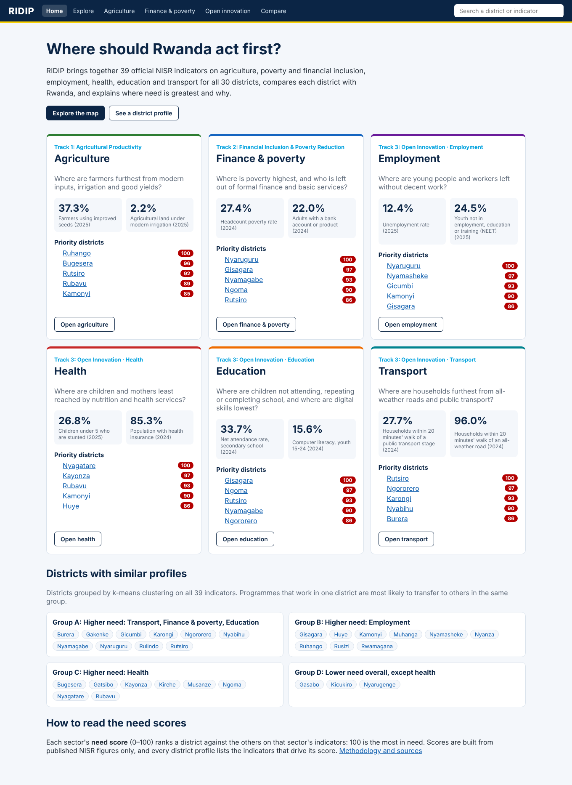
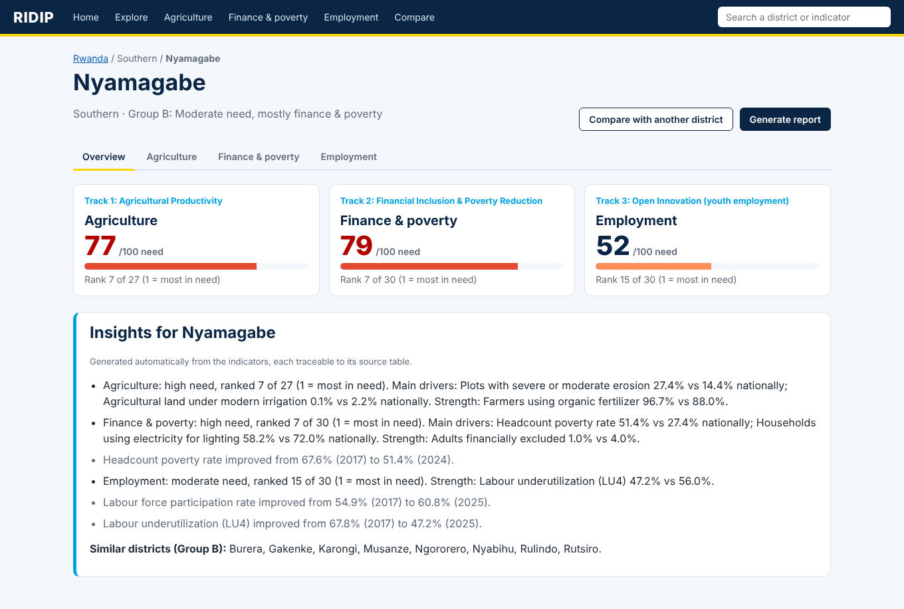

# RIDIP: Rwanda Integrated Data Intelligence Platform

**Live app: https://ridip.onrender.com** · [API documentation](https://ridip.onrender.com/docs) · [Methodology](docs/methodology.md) · [Tracks and NST2 alignment](docs/tracks.md) · [Design diagrams](docs/diagrams/RIDIP_Design_Diagrams.pdf) · [Priority advisor](docs/priority-advisor.md) · [Validation](docs/validation.md) · [Project guide](docs/project-guide.md)

**Demo video (2 min 45 s):** [`demo/RIDIP_demo.webm`](demo/RIDIP_demo.webm)

RIDIP turns official NISR statistics into district decisions. For all 30 districts it brings together **39 indicators** across six sectors and the three hackathon tracks, compares each district with Rwanda, ranks relative need, explains which indicators drive it, and produces a rules-based priority brief for planners.

Built by **Datanomics Tech** for the **NISR 2026 Big Data Hackathon**.



> The app runs on a free hosting plan. After 15 minutes without visitors it sleeps, so the first visit can take about a minute to load. The app shows a "server is waking up" message and retries by itself.

## The three tracks

| Track | Question RIDIP answers | NISR data |
| --- | --- | --- |
| **1. Agricultural Productivity** | Where are farmers furthest from improved seed, fertilizer, irrigation and good yields? | Seasonal Agricultural Survey 2025 |
| **2. Financial Inclusion & Poverty Reduction** | Where is poverty highest, and who is left out of formal finance and basic services? | EICV7 (2023/24), FinScope 2024 |
| **3. Open Innovation: employment** | Where are young people and workers left without decent work? | Labour Force Survey 2017–2025 |
| **3. Open Innovation: health** | Where are children and mothers least reached by nutrition and health services? | Rwanda DHS 2025, EICV7 |
| **3. Open Innovation: education** | Where are children not attending, repeating or completing school, and where are digital skills lowest? | EICV7 Education report (2017 and 2024) |
| **3. Open Innovation: transport** | Where are households furthest from all-weather roads and public transport? | EICV7 Utilities and Amenities report |

Each sector has its own page and its own tab in every district profile. See [docs/tracks.md](docs/tracks.md) for the problem, users, decisions supported and NST2 / Vision 2050 alignment of each track.

## What you can do

Following the journey in the design wireflows:

1. **Home** (`/`): *Start with a district*, headline national figures and the five highest-need districts for each sector (with a "rank sensitive" tag where relevant), plus district groups.
2. **Explore** (`/explore`, `/agriculture`, `/finance-poverty`, `/open-innovation/employment`, `/health`, `/education`, `/transport` under `/open-innovation/`): a choropleth map of any indicator and year, a ranked list of all districts, and a quick card for the selected district.
3. **District profile** (`/place/nyagatare`): need scores for the six sectors, automated insights with their drivers, and one tab per sector. Each tab shows every indicator with its gap to Rwanda, rank, approximate 95% interval and difference flag (where NISR publishes standard errors), national target (where verified), source link and year, and trend line.
4. **Compare** (`/compare?a=nyamagabe&b=musanze`): two districts side by side, with the better value highlighted.
5. **Priority brief** (`/brief/gicumbi?domain=health`): a one-page, rules-based evidence note for one district and sector: relative need, the indicators driving it, the national target, a planning question, follow-up steps and caveats. Print/PDF or CSV.
6. **Report builder** (`/reports/new?place=huye`): choose sections, then download a PDF (via print) or a CSV.
7. **Search** any district or indicator from the top bar. Every page has a shareable link.



## Innovation: explainable analytics

- **Need score (0–100) per district and sector.** Indicators are standardised, oriented so that higher always means more need, averaged with equal weights and ranked. It shows **relative** need among districts, not absolute deprivation, a probability or a causal effect, and it is not an official NISR index. The drivers behind every score are listed.
- **Sensitivity analysis.** Every ranking is recomputed with each indicator left out in turn; the app shows each district's rank range and flags ranks that move more than 5 places.
- **Approximate 95% difference flag.** Where NISR publishes standard errors (EICV7), RIDIP flags whether a district is above or below Rwanda beyond sampling error (an approximation, documented). Elsewhere comparisons are labelled descriptive.
- **District Priority & Intervention Advisor.** Fixed rules (R0–R5) turn the evidence into a priority brief with rule ids, sources and caveats, and no causal claims. See [docs/priority-advisor.md](docs/priority-advisor.md).
- **District typology.** k-means clustering on all 39 indicators groups districts with similar profiles, so a programme that works in one district can be targeted at its peers.
- **Automated insights.** Plain-language findings such as main drivers, strengths and trends, each traceable to its source table.

Details: [docs/methodology.md](docs/methodology.md).

## What the data shows

- Poverty fell from **39.8% (2017) to 27.4% (2024)** nationally and in every district, but still ranges from **6.8% (Nyarugenge) to 51.4% (Nyamagabe)**.
- Use of improved seeds ranges from **11.1% of farmers in Ngororero to 55.2% in Nyagatare**. Modern irrigation covers **2.2%** of agricultural land nationally (press coverage of NST2 cites an aim to expand irrigated land by 85%; not found in the official deck, so not shown as a target).
- Youth NEET fell nationally from **34.2% (2017) to 24.5% (2025)**, but is still **35.5% in Gisagara**. Unemployment ranges from **7.0% (Gakenke) to 18.4% (Nyamasheke)**.
- Mobile money has made **92%** of adults formally included, yet only **22%** are banked, and as few as **6% in Nyaruguru**.
- Child stunting is **26.8%** nationally (2025), from **8.7% in Nyarugenge to 38.8% in Gicumbi**, against the NST2 national target of 15% by 2029 (MINECOFIN).
- Only **33.7%** of secondary-age youth attend secondary school, and computer literacy among 15–24 year-olds is **15.6%**.
- Just **27.7%** of households live within 20 minutes' walk of a public transport stage, and only **7.9% in Rutsiro**.

## Data sources

| Data | Source | Indicators |
| --- | --- | --- |
| EICV7 Poverty Profile, Annex B | [NISR](https://www.statistics.gov.rw/sites/default/files/documents/2025-07/EICV7_Poverty%20Profile.pdf) | Poverty 2017 (modelled) and 2024 |
| EICV7 Main Indicators Report, district annex tables | [NISR](https://www.statistics.gov.rw/sites/default/files/documents/2025-07/EICV7_Main%20Indicator%20Report.pdf) | Health insurance, smartphone, internet, electricity, poverty standard errors |
| FinScope Rwanda 2024, Figures 5 and 13 | [NISR / AFR](https://statistics.gov.rw/sites/default/files/documents/2024-09/Rwanda-Finscope-2024-Report_compressed.pdf) | Banked, formally included, excluded |
| Seasonal Agricultural Survey 2025, Annual Tables | [NISR](https://statistics.gov.rw/sites/default/files/documents/2025-12/SAS%202025_Annual%20Tables.xlsx) | Seeds, fertilizer, irrigation, erosion, maize and bean yields |
| Labour Force Survey 2025, Annual Tables | [NISR](https://statistics.gov.rw/sites/default/files/documents/2026-05/RWLFS_Annual_Tables_LFS2025.xlsx) | Unemployment, youth NEET, participation, employment ratio, underutilisation, earnings |
| Rwanda DHS 2025 Final Report, Appendix D | [NISR](https://statistics.gov.rw/sites/default/files/documents/2026-08/2025%20RDHS%20Final%20Report.pdf) | Stunting, modern contraception, birth registration, vitamin A, deworming |
| EICV7 Thematic Report: Education, Annex | [NISR](https://statistics.gov.rw/sites/default/files/documents/2025-04/EICV7_Thematic%20Report%20Education_N.pdf) | Attendance, completion, repetition, out of school, literacy, computer literacy |
| EICV7 Thematic Report: Utilities and Amenities, Annexes | [NISR](https://www.statistics.gov.rw/sites/default/files/documents/2025-05/EICV7_Thematic%20Report%20Amenities%20and%20Utilities%20%281%29.pdf) | Road and transport-stage access, bicycle and motorcycle ownership, mobile phones |
| District boundaries | [geoBoundaries](https://www.geoboundaries.org/) gbOpen RWA ADM2 (Open Data Rwanda / NISR), CC BY 4.0 | Map |
| Base map | © [OpenStreetMap](https://www.openstreetmap.org/copyright) contributors, ODbL | Map |

**Data in this repository:** [`data/seed/`](data/seed/) holds every value the app uses (`indicators.csv`, `indicator_values.csv`) with source notes. District boundaries are downloaded from geoBoundaries by `backend/scripts/load_districts.py`. The original NISR files are linked in the table above; they are not copied here because of their size. All values can also be downloaded from the app (`/api/data.csv`). How each file was processed is in [data/seed/README.md](data/seed/README.md).

## How it is built

The design (user flow, wireflows, use cases, architecture, navigation, sequence and entity-relationship diagrams) is in [docs/diagrams/RIDIP_Design_Diagrams.pdf](docs/diagrams/RIDIP_Design_Diagrams.pdf). The current build implements the wireflow journey; sign-in, alerts and administration pages from the design are next steps.

```
Browser (React + Leaflet) ──> FastAPI (Python) ──> PostgreSQL + PostGIS
                                  │
                                  ├── analytics: need scores, difference flag, sensitivity, k-means, insights, priority briefs
                                  └── also serves the built React app
```

| Layer | Technology |
| --- | --- |
| Frontend | React 19, TypeScript, Vite, Leaflet / react-leaflet |
| API and analytics | Python 3.12, FastAPI, SQLAlchemy |
| Database | PostgreSQL 16 with PostGIS |
| Data pipeline | Python scripts in `analytics/etl/` that turn NISR files into the seed tables |
| Hosting | Render (Docker) and Neon (database), both in Frankfurt |

### API

| Endpoint | Returns |
| --- | --- |
| `GET /api/indicators` | All 39 indicators with track, unit, source and years |
| `GET /api/indicators/{code}` | Values by year, nationally and per district, with standard errors |
| `GET /api/places/{code}` | District profile: indicators, gaps, ranks, trends, need scores, insights, group |
| `GET /api/places/{code}/priority-brief?domain=` | Rules-based priority brief for one district and sector |
| `GET /api/method` | Scoring rules, exclusions, source years, verified targets, sensitivity results |
| `GET /api/overview` | Need scores and priority districts per track, district groups |
| `GET /api/places/{code}/report.csv` | District profile as CSV |
| `GET /api/data.csv` | Every value, long format |
| `GET /api/districts` | District boundaries (GeoJSON) |
| `GET /health`, `GET /health/db` | Service and database status |

## Run it locally

You need Python 3.12, Node.js 24 and Docker Desktop.

```bash
git clone https://github.com/datanomics-tech/ridip.git
cd ridip
cp .env.example .env              # then set your own password in .env
docker compose up -d              # starts PostgreSQL + PostGIS

cd backend
python -m venv .venv
.venv\Scripts\activate            # Windows (macOS/Linux: source .venv/bin/activate)
pip install -r requirements.txt
python -m scripts.load_districts  # 30 district boundaries
python -m scripts.load_indicators # 39 indicators, 2,490 values
python -m pytest -q               # 22 tests
uvicorn app.main:app --reload     # API on http://127.0.0.1:8000
python scripts/smoke_test.py http://127.0.0.1:8000   # 15 end-to-end checks
```

In a second terminal:

```bash
cd frontend
npm install
npm run dev                       # app on http://localhost:5173
```

## Project structure

```
backend/        FastAPI app, analytics, loading scripts and tests
frontend/       React app (pages: home, explore, sector pages, open innovation, district profile, priority brief, compare, report, about)
analytics/etl/  Scripts that build data/seed/ from the official NISR files
data/seed/      Indicator tables loaded into the database, with source notes
demo/           Demo video (RIDIP_demo.webm, under 3 minutes)
eligibility/    Student cards / official documents confirming eligibility of both members
database/       Database initialisation (PostGIS)
docs/           Project guide, methodology, priority advisor, validation record and logs, improvements checklist, tracks and NST2 alignment, AI-use disclosure, diagrams
Dockerfile      One container serving the API and the built app
```

## Known limitations

- Need scores are **relative** and use equal weights (an analytical choice). A low score does not mean no need.
- Scores and briefs are descriptive. They do not show causes or predict the effect of a programme.
- Sectors combine surveys from different years (2024–2025; poverty trend from NISR's 2017 modelled estimates).
- Only EICV7 indicators publish standard errors; the difference flag is approximate and other comparisons are descriptive.
- Health and agriculture rankings are sensitive to single indicators (see the [sensitivity table](docs/methodology.md#sensitivity-analysis-leave-one-indicator-out)).
- District averages hide variation within districts. The free hosting sleeps when idle.

## Responsible use

- Only published, aggregated district statistics. No personal or household-level data.
- Survey estimates carry sampling error. RIDIP shows approximate intervals where NISR publishes standard errors, and need scores rank districts rather than measure need in absolute terms.
- Generative AI was used during development. See [docs/ai-use.md](docs/ai-use.md).

## Team

**Datanomics Tech**, NISR 2026 Big Data Hackathon.
