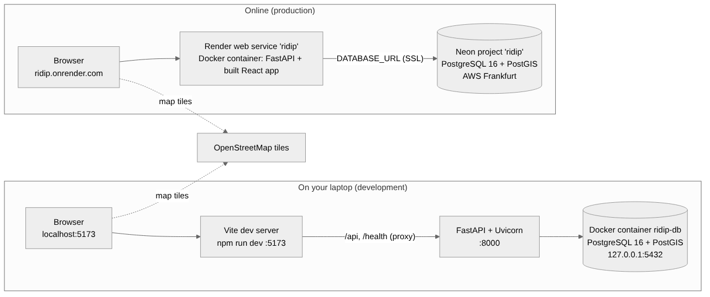
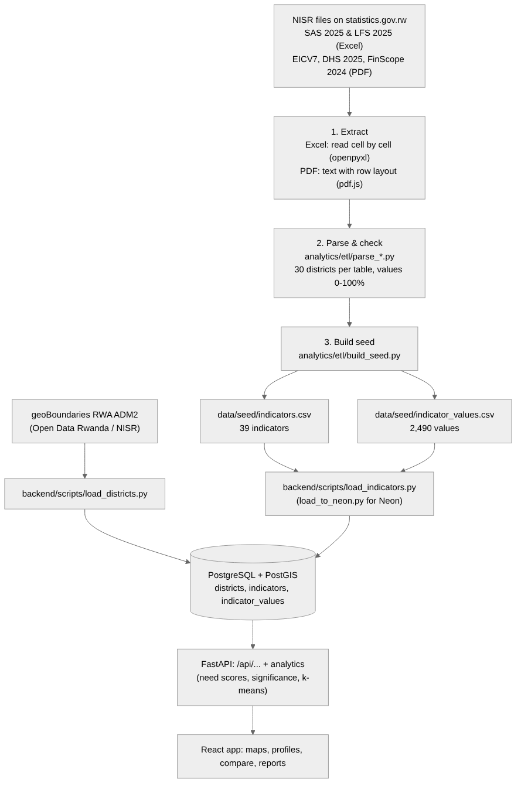
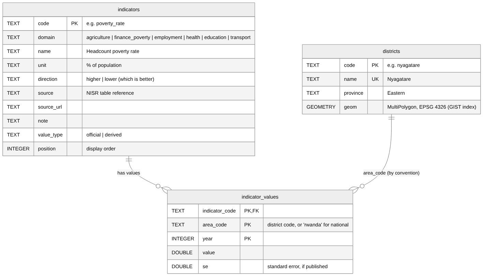
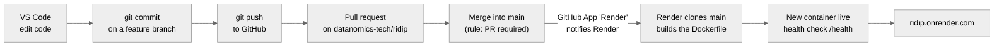

# RIDIP Project Guide

**Rwanda Integrated Data Intelligence Platform · Datanomics Tech · NISR 2026 Big Data Hackathon**
Handover guide, 29 October 2026

This guide explains the whole project from start to finish: where the data comes from and how it reaches the app, how the code and database are organised, every page and what it does, how the tests work, and how the local and online servers are set up and kept in sync through GitHub. Read it in order the first time; later, use it as a reference.

| Live app | Repository | API documentation |
| --- | --- | --- |
| https://ridip.onrender.com | https://github.com/datanomics-tech/ridip | https://ridip.onrender.com/docs |

---

## 1. What RIDIP does

RIDIP gathers **39 official NISR indicators for all 30 districts** in six sectors. It compares each district with Rwanda, gives a **need score (0–100)** per sector, explains the score in plain language, and lets users map, compare and download the data.

| Hackathon track | Sector(s) in RIDIP | Main NISR sources |
| --- | --- | --- |
| Track 1: Agricultural Productivity | Agriculture | Seasonal Agricultural Survey (SAS) 2025 |
| Track 2: Financial Inclusion & Poverty Reduction | Finance & poverty | EICV7 (2023/24), FinScope 2024 |
| Track 3: Open Innovation | Employment, Health, Education, Transport | Labour Force Survey (LFS) 2025, Rwanda DHS 2025, EICV7 thematic reports |

The user journey follows the design wireflows (`docs/diagrams/RIDIP_Design_Diagrams.pdf`): **Home → Explore (map) → District profile → Compare → Report**.

---

## 2. The big picture



There are two copies of the system:

- **Local (your laptop)** is for development. The React app runs on the Vite dev server (port 5173), the API on Uvicorn (port 8000), and the database in a Docker container (port 5432).
- **Online (production)** is what judges and users see. One Docker container on **Render** serves both the API and the built React app at ridip.onrender.com. It reads from a PostgreSQL database hosted by **Neon**.

The browser never talks to the database directly. It asks the API, and the API reads the database. Map background tiles come straight from OpenStreetMap.

**One request, step by step (online):**

1. A user opens `https://ridip.onrender.com/place/huye`.
2. Render passes the request to the FastAPI app in the container.
3. That path is not an API path, so FastAPI returns the React app (`index.html` + JavaScript).
4. The React router sees `/place/huye` and shows the district profile page.
5. The page calls `GET /api/places/huye`. FastAPI reads Neon, computes scores and insights, and returns JSON.
6. React draws the cards, charts and insights.

---

## 3. Tools and accounts

| What | Used for | Account / version |
| --- | --- | --- |
| GitHub | Code, history, pull requests | Shared account **datanomics-tech**; repo `datanomics-tech/ridip` (public) |
| Render | Hosts the web app (free plan) | Signed in with GitHub as datanomics-tech; workspace **Datanomics Tech** |
| Neon | Hosts the online database (free plan) | Signed in with GitHub as datanomics-tech; project **ridip** |
| Docker Desktop | Runs the local database | Docker 29.8 / Desktop 4.94 on Windows 11 with WSL 2 |
| VS Code | Editing, terminal (PowerShell) | — |
| Python | Backend and data scripts | 3.12 (virtual environment in `backend/.venv`) |
| Node.js | Frontend build | 24 (npm 11) |
| Git | Version control | Identity: `Datanomics Tech` / `217638769+datanomics-tech@users.noreply.github.com` |

**Free plan limits to know**

- **Render free web service:** sleeps after **15 minutes** without visitors; the next visit takes about **1 minute** to wake it. 750 free instance hours a month. Open the site a minute before any demo.
- **Neon free plan:** 1 GB storage per project; the database pauses after 5 minutes idle and wakes on the next query (a second or two). It does not expire. (Render's own free database is deleted after 30 days, which is why we use Neon.)

---

## 4. The codebase: where everything is

```
ridip/
├── README.md                  Project overview (first thing judges read)
├── Dockerfile                 How Render builds the online container (frontend + backend)
├── .dockerignore              Files kept out of the Docker build
├── docker-compose.yml         Local database container (PostgreSQL 16 + PostGIS)
├── .env.example               Template for local settings (committed, no real password)
├── .env                       Your real local settings (NEVER committed)
├── .gitignore                 What Git must ignore (.env, node_modules, raw data…)
│
├── backend/                   Python API (FastAPI)
│   ├── requirements.txt       Python packages, pinned versions
│   ├── app/
│   │   ├── main.py            All API routes; also serves the built React app online
│   │   ├── config.py          Reads DATABASE_URL (from .env locally, from Render online)
│   │   ├── db.py              Database connection (SQLAlchemy engine) + health check
│   │   ├── districts.py       District boundaries → GeoJSON for the map
│   │   ├── indicators.py      Reads indicators/values; refreshes its cache every 5 minutes
│   │   ├── analytics.py       Need scores, difference flag, sensitivity, k-means groups, insights, priority briefs
│   │   └── domains.py         The six sectors: titles, questions, NST2 alignment text
│   ├── scripts/
│   │   ├── load_districts.py  Downloads boundaries, creates & fills `districts`
│   │   ├── load_indicators.py Creates & fills `indicators` + `indicator_values` from data/seed
│   │   └── load_to_neon.py    Same as load_indicators, but asks for the Neon connection string
│   └── tests/                 Automated tests (pytest), see section 9
│
├── frontend/                  React app (TypeScript, Vite, Leaflet)
│   ├── index.html             Page shell
│   ├── package.json           npm packages and scripts (dev, build)
│   ├── vite.config.ts         Dev server; forwards /api and /health to port 8000
│   └── src/                   App code, see section 8
│
├── analytics/etl/             Data pipeline: NISR files → seed tables, see section 5
├── data/
│   ├── seed/                  The data the app loads (committed, 2 CSV files)
│   ├── raw/                   Downloads (ignored by Git), e.g. district boundaries
│   ├── processed/, metadata/  Placeholders from the original structure
├── database/init/01-extensions.sql   Enables PostGIS the first time the local database starts
├── docs/                      Documentation: guide, methodology, tracks, AI use, diagrams
├── notebooks/, docker/       Placeholders from the original structure
```

---

## 5. The data: from NISR to the app



### 5.1 Where the data comes from

All values are **published, aggregated district statistics** from NISR. No personal or household-level data is used.

| Sector | Source (publisher) | Tables used | Year(s) |
| --- | --- | --- | --- |
| Agriculture | [Seasonal Agricultural Survey 2025, Annual Tables (Excel)](https://statistics.gov.rw/sites/default/files/documents/2025-12/SAS%202025_Annual%20Tables.xlsx) | 9, 11, 19, 33, 43, 46, 76 (Season A) | 2025 |
| Finance & poverty | [EICV7 Poverty Profile](https://www.statistics.gov.rw/sites/default/files/documents/2025-07/EICV7_Poverty%20Profile.pdf) | Annex B (poverty by district) | 2017 (modelled), 2024 |
| Finance & poverty | [EICV7 Main Indicators Report](https://www.statistics.gov.rw/sites/default/files/documents/2025-07/EICV7_Main%20Indicator%20Report.pdf) | A3.7, A5.14, A5.15, A5.19, A9.23 (with standard errors) | 2024 |
| Finance & poverty | [FinScope Rwanda 2024 (NISR / AFR)](https://statistics.gov.rw/sites/default/files/documents/2024-09/Rwanda-Finscope-2024-Report_compressed.pdf) | Figure 13 (districts), Figure 5 (national) | 2024 (national also 2020) |
| Employment | [Labour Force Survey 2025, Annual Tables (Excel)](https://statistics.gov.rw/sites/default/files/documents/2026-05/RWLFS_Annual_Tables_LFS2025.xlsx) | Table 1 (Rwanda), Tables 21–25 (districts) | 2017–2025 |
| Health | [Rwanda DHS 2025 Final Report](https://statistics.gov.rw/sites/default/files/documents/2026-08/2025%20RDHS%20Final%20Report.pdf) | Appendix D: D.1, D.3, D.4, D.6 | 2025 |
| Education | [EICV7 Thematic Report: Education](https://statistics.gov.rw/sites/default/files/documents/2025-04/EICV7_Thematic%20Report%20Education_N.pdf) | Annex A.3, A.5, A.11, A.16, A.19, A.22, A.27 | 2024 (literacy also 2017) |
| Transport | [EICV7 Thematic Report: Utilities and Amenities](https://www.statistics.gov.rw/sites/default/files/documents/2025-05/EICV7_Thematic%20Report%20Amenities%20and%20Utilities%20%281%29.pdf) | A.28, A.31, B.11, B.12, B.14 | 2024 |
| Map | [geoBoundaries gbOpen RWA ADM2](https://www.geoboundaries.org/) (Open Data Rwanda / NISR, CC BY 4.0) | District boundaries | — |

The full list of the 39 indicators, with units and the exact table for each, is in `docs/methodology.md` and on the app's **About** page.

### 5.2 How the data was extracted (step by step)

1. **Found the files** on statistics.gov.rw (survey pages → report or "Annual Tables").
2. **Excel files (SAS, LFS):** downloaded and read cell by cell with Python (`openpyxl`). No retyping.
3. **PDF reports (EICV7, DHS, FinScope):** opened in a browser and read with pdf.js, keeping each line's layout, so that every table row comes out as `District | value | value | …`. The extracted pages are saved in `analytics/etl/` (`dhs_annex.txt`, `edu_annex.txt`, `util_annex.txt`, `eicv7_mir_tables.json`).
4. **FinScope Figure 13** is a bar chart, not a table. Its printed data labels were read with their positions on the page (`finscope2024_fig13_items.txt`), and `parse_finscope.py` rebuilt each district's four shares. Check: every district must add up to 100% (±1 for rounding).
5. **Poverty (Annex B)** was also checked row by row against the report and the EICV7 booklet's district map.

### 5.3 How it becomes the app's data (the pipeline)

| Step | File | What it does |
| --- | --- | --- |
| Parse PDF tables | `analytics/etl/parse_mir.py`, `parse_tables.py` | Finds a table by its title, takes the row for each of the 30 districts and the national row. Fails if any district is missing. |
| Parse chart | `analytics/etl/parse_finscope.py` | Rebuilds FinScope Figure 13 and checks the 100% totals. |
| Build seed | `analytics/etl/build_seed.py` | Reads every source, applies the definitions (e.g. irrigation = irrigated ha ÷ agricultural ha), checks all 30 districts are covered, and writes the two seed files. |
| Seed files | `data/seed/indicators.csv` (39 rows), `data/seed/indicator_values.csv` (2,490 rows) | The app's data, committed to Git. |
| Load | `backend/scripts/load_indicators.py` | Recreates the two tables and inserts every row, after checking codes, areas and coverage. |

To rebuild the seed files from the original NISR files, follow `data/seed/README.md`. You only need this if NISR publishes new data.

### 5.4 Loading data into a database

```powershell
cd C:\Users\USER\projects\ridip\backend
.\.venv\Scripts\Activate.ps1
python -m scripts.load_districts      # once: 30 district boundaries (local database)
python -m scripts.load_indicators     # local: "Loaded 39 indicators and 2490 values."
python -m scripts.load_to_neon        # online: paste the Neon string at the hidden prompt
```

Both loaders are safe to run again: they rebuild the tables from the seed files. The online app picks up new data within 5 minutes; to see it at once, restart the Render service (section 10.3).

---

## 6. The database



The same structure exists locally (Docker) and online (Neon). Both run **PostgreSQL 16 with the PostGIS extension** (for map shapes).

### 6.1 Tables

**`districts`** (created by `load_districts.py`)

| Column | Type | Meaning |
| --- | --- | --- |
| `code` | TEXT, primary key | Lower-case district name, e.g. `nyagatare`. Used in URLs and everywhere else. |
| `name` | TEXT, unique | Display name, e.g. `Nyagatare` |
| `province` | TEXT | City of Kigali, Eastern, Northern, Southern or Western |
| `geom` | geometry(MultiPolygon, 4326) | District boundary in GPS coordinates; spatial (GIST) index |

**`indicators`** (created by `load_indicators.py`)

| Column | Meaning |
| --- | --- |
| `code` (primary key) | Short id, e.g. `poverty_rate`, `ag_improved_seeds`, `health_stunting` |
| `domain` | Sector: `agriculture`, `finance_poverty`, `employment`, `health`, `education`, `transport` |
| `name`, `unit` | Display name and unit, e.g. `% of population`, `kg per hectare`, `Frw per month` |
| `direction` | `higher` or `lower`: which way is better. Drives map colours, ranks and scores. |
| `source`, `source_url` | Exact NISR table and link |
| `note` | How a derived value is calculated, or caveats |
| `value_type` | `official` (as published) or `derived` (calculated by RIDIP from published columns) |
| `position` | Display order in the app |

**`indicator_values`** (created by `load_indicators.py`)

| Column | Meaning |
| --- | --- |
| `indicator_code` | Which indicator (foreign key to `indicators.code`) |
| `area_code` | A district `code`, or **`rwanda`** for the national value |
| `year` | Survey year, e.g. 2024 (EICV7 2023/24), 2025 |
| `value` | The number |
| `se` | Standard error where NISR publishes one (EICV7 tables), else empty |

Primary key: (`indicator_code`, `area_code`, `year`); index on `area_code`. This "long" design means a new indicator or year is new **rows**, never new columns or code.

### 6.2 Looking at the data yourself

Local database:
```powershell
docker exec -it ridip-db psql -U ridip -d ridip
```
Online: Neon dashboard → project **ridip** → **SQL Editor**. Useful queries:
```sql
SELECT domain, count(*) FROM indicators GROUP BY domain;   -- agriculture 7, finance_poverty 8, employment 6, health 6, education 7, transport 5
SELECT * FROM indicator_values WHERE indicator_code = 'poverty_rate' AND area_code = 'nyamagabe';
SELECT name, province, ST_Area(geom::geography)/1e6 AS km2 FROM districts ORDER BY km2 DESC LIMIT 5;
```

---

## 7. The backend (API)

### 7.1 How it starts

`uvicorn app.main:app` loads `main.py`. `config.py` reads `DATABASE_URL`: from the root `.env` file locally, or from Render's environment variable online (the environment variable wins). It also converts the `postgresql://` link that Neon gives into the `postgresql+psycopg://` form SQLAlchemy needs. `db.py` creates one shared connection pool.

### 7.2 API endpoints

| Endpoint | Returns | Used by |
| --- | --- | --- |
| `GET /health` | `{"status":"ok"}`; Render's health check | Render |
| `GET /health/db` | PostgreSQL and PostGIS versions | You, to test the database link |
| `GET /api/districts` | 30 district boundaries as GeoJSON | Maps, search |
| `GET /api/domains` | The six sectors and their NST2 text | Explore, About |
| `GET /api/indicators` | All 39 indicators with years | Explore picker, search, About |
| `GET /api/indicators/{code}` | One indicator: values by year for Rwanda and every district, with standard errors | Explore map and ranking |
| `GET /api/places/{code}/priority-brief?domain=<sector>` | Rules-based priority brief (rule ids, evidence, caveats) | Priority brief |
| `GET /api/method` | Scoring rules, exclusions, source years, verified targets, sensitivity | About |
| `GET /api/overview` | Need scores and top-5 priority districts per sector; district groups | Home, Open innovation |
| `GET /api/places/{code}` | Full district profile: every indicator with gap, rank, trend, approximate difference flag, target, source; need scores; insights; group | Profile, Compare, Report |
| `GET /api/places/{code}/report.csv` | The profile as a CSV file | Report (CSV) |
| `GET /api/data.csv` | Every value, one row each | About (download) |
| `GET /docs` | Interactive API documentation (automatic) | Developers |
| any other path | The React app (`index.html`) | Browsers (online only) |

### 7.3 The analytics (`analytics.py`)

1. **Latest year per indicator** in which all 30 districts have a value.
2. **Oriented z-scores:** each indicator is standardised across districts and flipped where needed, so a positive number always means "worse than the average district".
3. **Need score per sector:** the average of that sector's z-scores, turned into a percentile (100 = most in need). The three City of Kigali districts are not ranked on agriculture.
4. **Drivers and strengths:** indicators with z above 0.5 (drivers) or below −0.5 (strengths) are named in the insights.
5. **Approximate 95% difference flag:** where standard errors exist, a district is flagged above/below Rwanda when the gap exceeds 1.96 × √(SE district² + SE Rwanda²). It is an approximation (ignores covariance and survey design), so it is never called "statistically significant". Without standard errors the comparison is labelled descriptive.
5b. **Safeguards:** coverage rule, zero-variance exclusion, alphabetical tie policy (all tested in `tests/test_method.py`).
5c. **Sensitivity:** each sector re-ranked with each indicator left out; rank range per district; rank "stable" if it never moves more than 5 places.
6. **District groups:** k-means clustering (k = 4, deterministic start) on all 39 z-scores; each group is named by its highest-need sectors.
7. **Insights:** fixed sentence rules (no AI model), e.g. "Poverty improved from 67.6% (2017, modelled) to 51.4% (2024)".
8. **Priority brief:** rules R0–R5 (see `docs/priority-advisor.md`), with one verified national target (stunting 15% by 2029) from `domains.py`.

Results are cached and recalculated when the data changes (checked every 5 minutes).

---

## 8. The frontend (web pages)

### 8.1 Every page, its address and its job

| Page | Address (URL) | File | What it does |
| --- | --- | --- | --- |
| Home | `/` | `src/pages/Home.tsx` | Start with a district, six sector cards (national figures + 5 highest-need districts, "rank sensitive" tags), district groups, how to read scores |
| Explore | `/explore?i=<indicator>&y=<year>&place=<district>` | `src/pages/Explore.tsx` | Map of any indicator, year picker, ranked list, quick card with "Open profile" |
| Sector pages | `/agriculture`, `/finance-poverty`, `/open-innovation/employment`, `/open-innovation/health`, `/open-innovation/education`, `/open-innovation/transport` | `src/pages/Explore.tsx` (limited to one sector) | The explorer for one sector, with its question |
| Open innovation | `/open-innovation` | `src/pages/OpenInnovation.tsx` | Cards for the four Track 3 sectors |
| District profile | `/place/<district>` and `?tab=<sector>` | `src/pages/Place.tsx` | Six need scores, insights, similar districts; one tab per sector with indicator cards (value, gap, rank, approximate interval and difference flag, national target, source link and year, trend line) and Priority brief buttons |
| Priority brief | `/brief/<district>?domain=<sector>` | `src/pages/Brief.tsx` | Rules-based evidence note: relative need, drivers with sources, national target, planning question, follow-up steps, caveats; print/PDF and CSV |
| Compare | `/compare?a=<district>&b=<district>` | `src/pages/Compare.tsx` | Two districts side by side, better value highlighted |
| Report builder | `/reports/new?place=<district>` | `src/pages/Report.tsx` | Choose sections and PDF (browser print) or CSV, then download |
| About | `/about` | `src/pages/About.tsx` | Methodology, safeguards, sensitivity table, verified targets, limitations, every indicator with its source, data download, API link |

Every page has its own address, so any view can be shared as a link.

### 8.2 Shared building blocks

| File | Role |
| --- | --- |
| `src/main.tsx` | Starts React; loads the map and page styles |
| `src/App.tsx` | Chooses the page from the URL |
| `src/router.tsx` | Tiny router: `Link`, `navigate`, `useLocation` (no extra library) |
| `src/Nav.tsx` | Top bar on every page: links and the search box (district or indicator) |
| `src/api.ts` | All calls to the API, with a small in-memory cache and automatic retry while the free server wakes |
| `src/ServerBanner.tsx` | "Server is waking up" message under the top bar |
| `src/types.ts` | Data shapes (TypeScript types) and the sector order |
| `src/tracks.ts` | Links and headline indicators for each sector card |
| `src/TrackCard.tsx` | One sector card (Home, Open innovation) |
| `src/DistrictMap.tsx` | Leaflet map of the 30 districts, coloured by need |
| `src/colours.ts` | Colour scale: light = better off, dark red = most in need (fifths of districts) |
| `src/Sparkline.tsx` | Small trend chart: district (solid) vs Rwanda (dashed) |
| `src/format.ts` | Number formatting (%, Frw, kg/ha) and gap wording |
| `src/styles.css` | All styling, including phone layout and print layout for reports |

Locally, `npm run dev` serves these files with live reload. Online, `npm run build` (inside the Docker build) turns them into static files in `frontend/dist`, which FastAPI serves.

---

## 9. Testing

### 9.1 Automated tests

Run from `backend` with the virtual environment active and the local database running:

```powershell
python -m pytest -q        # expected: 22 passed
```

| File | What it checks |
| --- | --- |
| `tests/test_health.py` | `/health` answers OK (works even without a database) |
| `tests/test_db.py` | `/health/db` reaches the database and PostGIS is enabled |
| `tests/test_districts.py` | 30 districts returned as GeoJSON, with known names |
| `tests/test_indicators.py` | 39 indicators in 6 sectors; sample values match the source tables exactly (e.g. Nyamagabe poverty 67.6 → 51.4, Gicumbi stunting 38.8, Bugesera bicycles 32.7 ± 3.3); unknown indicator gives 404 |
| `tests/test_method.py` | Method safeguards (orientation, coverage, zero variance, ties, Kigali), sensitivity, difference flag only with standard errors, priority brief deterministic/traceable/non-causal, 404s |
| `tests/test_places.py` | District profile has 6 sectors, insights and a group; Kigali not ranked on agriculture; overview has 5 priorities per sector; CSV downloads have the right number of rows; unknown district gives 404 |

Tests that need data are **skipped** (not failed) when the database or data is missing; a run showing "skipped" means the database is not running or not loaded.

### 9.1b Smoke test (local or live)

```powershell
python backend/scripts/smoke_test.py                          # live site
python backend/scripts/smoke_test.py http://127.0.0.1:8000    # local
```

15 checks over the main pages and API routes; exits with an error if any fails. Results are recorded in `docs/validation.md`.

### 9.2 Manual page checks (before a demo or after a deploy)

| Open | You should see |
| --- | --- |
| `/health/db` | PostgreSQL and PostGIS versions |
| `/` | Six sector cards with numbers and priority districts |
| `/explore?i=poverty_rate` | Coloured map and ranked list of 30 districts |
| `/place/nyamagabe` | Six need scores and insights; each tab shows cards |
| `/compare?a=nyamagabe&b=musanze` | Table with highlighted values |
| `/reports/new?place=huye` | Report preview; PDF opens the print dialog; CSV downloads |
| `/about` | Indicator list with sources |

---

## 10. Configuration of the servers

### 10.1 Local setup (one time)

1. Install Python 3.12, Node.js 24, Docker Desktop (with WSL 2), Git and VS Code.
2. `git clone https://github.com/datanomics-tech/ridip.git` into `C:\Users\USER\projects`.
3. Copy `.env.example` to `.env` and set a strong `POSTGRES_PASSWORD`, using the same password inside `DATABASE_URL`. Use `127.0.0.1`, not `localhost` (avoids a slow IPv6 attempt on Windows).
4. `docker compose up -d` (in the repo root): starts **ridip-db** (image `postgis/postgis:16-3.4`), data kept in the Docker volume `ridip_pgdata`, reachable only from your laptop at `127.0.0.1:5432`. `database/init/01-extensions.sql` enables PostGIS the first time.
5. Backend: `cd backend`, `python -m venv .venv`, `.\.venv\Scripts\Activate.ps1`, `pip install -r requirements.txt`, then the two loaders (section 5.4).
6. Frontend: `cd frontend`, `npm install`.

### 10.2 Daily local use

| Terminal | Command | Address |
| --- | --- | --- |
| 1 | `docker compose up -d` (if not running) | database on 127.0.0.1:5432 |
| 2 | `cd backend` → activate venv → `uvicorn app.main:app --reload` | API on http://127.0.0.1:8000 (docs at /docs) |
| 3 | `cd frontend` → `npm run dev` | App on http://localhost:5173 |

`vite.config.ts` forwards `/api` and `/health` from 5173 to 8000, so the app works exactly as online. If PowerShell blocks npm, run once: `Set-ExecutionPolicy -Scope CurrentUser RemoteSigned`.

### 10.3 Online: Render (web app)

| Setting | Value |
| --- | --- |
| Service type / name | Web Service, **ridip** |
| Source | GitHub repo `datanomics-tech/ridip`, branch **main** |
| Language | **Docker** (uses the repo's `Dockerfile`) |
| Region / plan | Frankfurt (EU Central) / **Free** |
| Environment variable | `DATABASE_URL` = the Neon connection string (secret; set only in Render) |
| Health check path | `/health` |
| Address | https://ridip.onrender.com |

How the `Dockerfile` builds the container:
1. Stage 1 (`node:24-slim`): `npm ci` then `npm run build` → the React app in `frontend/dist`.
2. Stage 2 (`python:3.12-slim`): installs `requirements.txt`, copies `backend/`, `data/seed/` and the built React app.
3. Runs as a non-root user and starts `uvicorn app.main:app` on the port Render gives (`$PORT`).

Useful Render actions (dashboard → **ridip**): **Logs** (live requests and errors), **Events** (deploy history), **Environment** (edit `DATABASE_URL`), **Manual Deploy → Deploy latest commit / Restart service**.

### 10.4 Online: Neon (database)

| Setting | Value |
| --- | --- |
| Project / database | **ridip** / **ridip** |
| Region | AWS Europe Central 1 (Frankfurt), close to Render |
| PostgreSQL | 16, with PostGIS (enabled by `load_districts.py`) |
| Role | `ridip_owner` |
| Connection | Dashboard → **Connect** → copy the string (`postgresql://…neon.tech/ridip?sslmode=require…`) |

The connection string contains the password. Never paste it into chat, screenshots, files or Git. If it is exposed: Neon → **Roles** → `ridip_owner` → **Reset password**, then update Render's `DATABASE_URL`.

---

## 11. Git, GitHub and automatic deployment



### 11.1 The workflow we used for every change

```powershell
git switch main
git pull                                  # start from the latest main
git switch -c feature/<short-name>        # one branch per change
# … edit, test locally …
git add <files>
git commit -m "Describe the change in one line"
git push -u origin feature/<short-name>
# GitHub → "Compare & pull request" → Create → Merge
git switch main
git pull
```

**Rules on `main`** (GitHub ruleset `protect-main`): changes only through pull requests; 0 approvals needed (one shared account cannot approve its own pull requests); force pushes blocked.

### 11.2 Project history (branches, in order)

| Branch | What it added |
| --- | --- |
| `setup/project-structure` | Folders, `.gitignore`, README |
| `feature/backend-skeleton` | FastAPI app with `/health` and first test |
| `feature/database` | Docker PostgreSQL + PostGIS, `/health/db` |
| `feature/district-map` (PR #4) | District boundaries, `/api/districts`, React map |
| `feature/poverty-map` (PR #5) | First indicator (EICV7 poverty), choropleth |
| `feature/deploy` (PR #6) | Dockerfile; API serves the React app; deployed to Render + Neon |
| `feature/three-tracks` (PR #7) | 21 indicators, need scores, profiles, compare, reports, docs |
| `feature/more-sectors` (PR #8) | Health, education, transport (39 indicators) |
| `fix/data-refresh` | 5-minute data refresh, Neon loader, safer pages |
| `docs/diagrams` | Design diagrams and this guide |
| `feature/final-improvements` | Honest labels, method safeguards and tests, sensitivity, priority brief, wake-up banner, validation record |

### 11.3 How Render gets the code from GitHub

1. When Render was set up, the **Render GitHub App** was installed on the datanomics-tech account with access to the `ridip` repository only.
2. Every merge into `main` makes GitHub notify Render.
3. Render clones `main`, builds the `Dockerfile` (a few minutes) and checks `/health`.
4. If the check passes, the new version replaces the old one; if the build fails, the old version keeps running and the error is shown in **Logs**.

The database is **not** deployed this way. Data changes are loaded into Neon with `load_to_neon.py` (section 5.4).

---

## 12. Common tasks

**Add a new indicator**
1. Add its extraction to `analytics/etl/build_seed.py` (code, sector, name, unit, direction, source) and rebuild the seed files, or add rows to the two CSVs by hand following the same columns.
2. `python -m scripts.load_indicators` locally; check the app; run the tests (update expected counts in the tests).
3. Commit through a pull request, then `python -m scripts.load_to_neon`.

**Add a page**: create `src/pages/<Name>.tsx`, add its path in `src/App.tsx`, and a link in `src/Nav.tsx` if needed.

**Change the online database password**: reset it in Neon, then Render → Environment → edit `DATABASE_URL` → **Save, rebuild, and deploy**.

---

## 13. Problems we met and how we fixed them

| Symptom | Cause | Fix |
| --- | --- | --- |
| `python` opens the Microsoft Store | Windows app alias | Install Python with "Add to PATH"; turn off the aliases |
| `npm.ps1 cannot be loaded` | PowerShell execution policy | `Set-ExecutionPolicy -Scope CurrentUser RemoteSigned` |
| `no configuration file provided` | `docker-compose.yml` not in the repo root | Run from the root |
| Tests slow (2+ minutes) | `localhost` tries IPv6 first | Use `127.0.0.1` in `.env` |
| `No module named 'scripts'` | Ran from the repo root | Run `python -m scripts…` from `backend` |
| Live site "Data could not be loaded" | Neon database empty or old | Run `load_to_neon.py`, then restart the Render service |
| Data loaded locally instead of Neon | `DATABASE_URL` not set in that terminal | Use `python -m scripts.load_to_neon` |
| Changes missing after switching branch | Committed on an old branch | `git cherry-pick <commit>` onto the right branch |
| Render can't see the repo | Render linked to a personal GitHub account | Sign in to Render with datanomics-tech; install the app on `ridip` |
| First visit takes a minute | Free Render service asleep | Open the site a minute early |

---

## 14. Security checklist

- `.env` and the Neon connection string are secrets: never commit, paste or screenshot them.
- `.env.example` holds placeholders only.
- The local database listens only on 127.0.0.1; the container runs as a non-root user.
- Only published, aggregated statistics are stored; no personal data.
- Generative AI was used in development and is disclosed in `docs/ai-use.md`.

## 15. Where to read more

- `README.md`: overview, findings, run instructions
- `docs/tracks.md`: problem, users and NST2 alignment per sector; evaluation criteria
- `docs/methodology.md`: every indicator, extraction checks, scoring method, limitations
- `docs/priority-advisor.md`: priority brief rules and worked example
- `docs/validation.md`: tests, build, smoke test and screenshots
- `docs/improvements-checklist.md`: final improvements and their evidence
- `docs/ai-use.md`: AI-use disclosure
- `data/seed/README.md`: rebuilding the data from NISR files
- `docs/diagrams/RIDIP_Design_Diagrams.pdf`: the design (user flow, wireflows, architecture, ERD)
